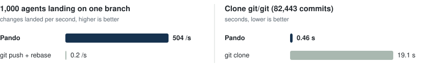
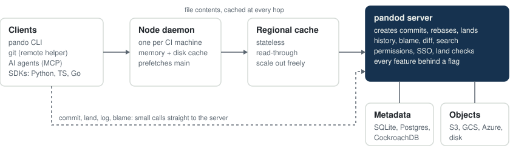

<p align="center">
  <a href="https://kabirnarang39.github.io/pando/"></a>
</p>

<h1 align="center">Pando</h1>

<p align="center">
  <b>Open-source source control for monorepos where hundreds of AI agents commit at once.</b><br>
  Commits, rebases and history run on the server. Clones take milliseconds, CI reads files
  without checking out, and concurrent changes land without a merge queue. Run it beside
  GitHub or Bitbucket, or instead of them.
</p>

<p align="center">
  <a href="https://github.com/kabirnarang39/pando/actions/workflows/ci.yml"></a>
  <a href="https://github.com/kabirnarang39/pando/releases"></a>
  <a href="LICENSE"></a>
  <a href="https://kabirnarang39.github.io/pando/docs/"></a>
  <a href="https://scorecard.dev/viewer/?uri=github.com/kabirnarang39/pando"></a>
</p>

<p align="center">
  <a href="https://kabirnarang39.github.io/pando/docs/">Documentation</a> ·
  <a href="https://kabirnarang39.github.io/pando/docs/getting-started.html">Getting started</a> ·
  <a href="docs/comparisons/git-vs-pando.md">Benchmarks</a> ·
  <a href="docs/ARCHITECTURE.md">Architecture</a>
</p>

<p align="center">
  <picture>
    <source media="(prefers-color-scheme: dark)" srcset="docs/assets/charts/headline-dark.svg">
    <source media="(prefers-color-scheme: light)" srcset="docs/assets/charts/headline-light.svg">
    
  </picture>
  <br>
  <sub>Both systems on one Apple M4 laptop, release builds. Reproduce with <a href="bench/run.sh"><code>bench/run.sh</code></a> and <a href="crates/pando/examples/land_load.rs"><code>examples/land_load.rs</code></a>.</sub>
</p>


<p align="center">
  <a href="https://kabirnarang39.github.io/pando/console/"><b>Try the web console</b></a>: a whole organisation of agents landing
  and reviewing changes, simulated in your browser.
</p>

## Why Pando

git gives every clone the full history and lets every pusher race for the same branch.
That works for people. It breaks when agents and CI land tens of thousands of changes a
day into one repository: every job clones history it never reads, and every push to
`main` loses to someone else's and retries.

Google, Meta and Microsoft solved this with in-house systems that move history and commit
creation to the server ([prior art](docs/PRIOR_ART.md)). Pando is that design as one
open-source binary: SQLite on a laptop, or stateless replicas on Postgres and S3 behind
caches.

## Beside GitHub, or instead of it

You choose how far to go, and can change your mind at any point.

- **Beside your git host.** Agents land in Pando; `pando mirror` pushes every landed change to
  GitHub, GitLab or Bitbucket as ordinary commits, so CI, code search, issue links and
  reviewers keep working where they are. Nothing to migrate; stop the mirror to roll back.
- **Instead of it.** Pando hosts your repositories, people browse and review in its web
  console, and plain git, CI and editors connect through `git-remote-pando`. The history
  stays exportable to git at any time, so there's no lock-in either way.

Most teams start beside and move the busiest repositories over once the numbers are in.
Change requests, reviews and protected branches run on the server, in the console and from
the CLI (`pando cr`), for people and agents alike.

## Highlights

- **Landing without a merge queue.** The server rebases concurrent changes that touch
  different files and moves the branch with one compare-and-swap per batch. 1,000 agents
  land 504 changes a second, with no client retries.
- **Clones without history.** A clone fetches one tree, lazily, only for the paths you ask
  for: 0.46 s for git/git's 82,443 commits, against 19.1 s for `git clone`. Or mount a
  revision on Linux, macOS or Windows and download files only when they are read.
- **CI without checkouts.** `pando cat main path/to/file` answers in 9 ms. History, blame,
  diff and search are server APIs.
- **Built for agents.** A built-in [MCP](https://modelcontextprotocol.io) server, plus
  Python, TypeScript and Go SDKs.
- **Plain git still works.** `git clone pando::https://…`, then push and pull as usual.
  Import and export round-trip with identical trees, so you can leave any time.
- **Ready for a company.** SSO through OpenID Connect, per-directory read and write
  permissions, pre-land checks for CI and review, file locking for assets that cannot be
  merged, an audit log, backups with `pandod copy`, TLS, Prometheus metrics.
- **Runs on what you have.** SQLite, Postgres or CockroachDB for metadata; disk, S3, GCS
  or Azure for objects. Every feature sits behind a flag.

## Quick start

```sh
brew install kabirnarang39/tap/pando        # or: curl -fsSL https://raw.githubusercontent.com/kabirnarang39/pando/main/install.sh | sh

pandod server --listen 127.0.0.1:7420 &     # a server on SQLite
pando import-git ~/code/my-repo --server http://127.0.0.1:7420

pando clone http://127.0.0.1:7420 work && cd work
echo hello > hello.txt && pando commit -m "Say hello" && pando land
```

<p align="center">
  
</p>

Docker, Postgres and S3 setups are in the [deployment guide](https://kabirnarang39.github.io/pando/docs/deploy.html).
Coming from git? The [command map](https://kabirnarang39.github.io/pando/docs/git-users.html) lists every equivalent.

## How it works

<p align="center">
  <picture>
    <source media="(prefers-color-scheme: dark)" srcset="docs/assets/charts/architecture-dark.svg">
    <source media="(prefers-color-scheme: light)" srcset="docs/assets/charts/architecture-light.svg">
    
  </picture>
</p>

- **The server creates commits.** A client sends the files it changed, not a tree; the
  server builds the commit in time proportional to the change.
- **Content is immutable and addressed by its BLAKE3 hash**, so every cache tier can answer
  any request and verify it. Only branch pointers change.
- **Landing is optimistic.** Changes that touch different paths all land; real conflicts
  fail alone and leave the branch untouched.

Read the [architecture](docs/ARCHITECTURE.md) and the [design decisions](docs/DECISIONS.md).

## Benchmarks

On git/git's history (82,443 commits), both systems on one machine:

| | git | Pando | |
|---|---:|---:|---|
| Full clone | 19.1 s | 0.46 s | 41× faster |
| Sparse clone of `Documentation/` | 9.5 s | 0.11 s | 90× faster |
| Read one file in CI, no clone | 149 ms | 9 ms | 16× faster |
| `log -n 50 -- builtin/add.c` | 100 ms | 19 ms | 5× faster |
| 1,000 agents landing on one branch | 0.2 /s | 504 /s | no client retries |
| Server storage after compaction | 333 MB | 369 MB | 1.1× git's pack |

Where git wins: working offline with full history. Methods, raw numbers and limits are on
the [benchmark page](docs/comparisons/git-vs-pando.md).

## Status

Pando is new and maintained by one person. The protocol (`pando.v1`), storage formats and
CLI follow semantic versioning, and CI runs the test suite on Linux, macOS and Windows.
The safest way to try it is next to git, through the git bridge. See the
[changelog](CHANGELOG.md) and [roadmap](docs/ROADMAP.md).

## Contributing

Issues and pull requests are welcome; start with [CONTRIBUTING.md](CONTRIBUTING.md).
Report security issues privately as described in [SECURITY.md](SECURITY.md).

Licensed under [Apache-2.0](LICENSE). Named after [Pando](https://en.wikipedia.org/wiki/Pando_(tree)),
a grove of some 47,000 aspen trunks that grow from one root system.
