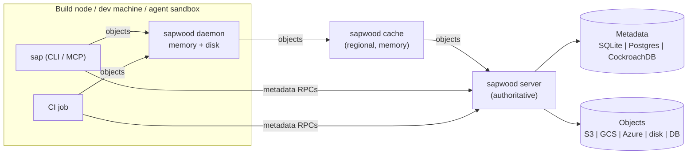

# Architecture

Sapwood is a client/server source control system designed around one observation: when
humans and AI agents merge tens of thousands of changes a day into one monorepo, the
expensive operations of git (full clones, client-side history, pushing whole packfiles,
merge queues behind a global lock) become the bottleneck. Sapwood moves history, commits,
merges and rebases to the server, keeps clients thin, and makes every read an API call.

## Topology



* **Server**: every feature. Stateless apart from its storage adapters, so several replicas
  can share one Postgres/CockroachDB + object store.
* **Cache** and **daemon**: serve only the `Objects` service. Objects are immutable and
  content-addressed, so a cached object is correct forever: no invalidation, no coherence
  protocol. Tiers speak the identical RPC, so a client cannot tell which tier answered.
* **Client**: holds no history. A workspace is the materialised tree of one changeset plus
  an index of file stats.

## Data model

| Concept | Representation |
|---|---|
| Object id | BLAKE3-256 of `kind byte ‖ content` (domain-separated) |
| Blob | file bytes; stored as `kind ‖ zstd(content)` |
| Tree | sorted `(name, mode, id)` entries (prost-encoded, canonical) |
| Changeset | `parents`, `changes` (path → blob or delete) **relative to first parent**, author, message, timestamp. Id = BLAKE3 of the canonical encoding |
| Ref | name → changeset id; moved only by compare-and-swap |
| Derived data | any value defined recursively from parents: root tree, generation number + skew-binary jump pointer |

A changeset stores *what changed*, not a tree. The root tree is derived data, computed
once by applying the changes to the parent's tree. Because trees are Merkle trees, applying
`k` changes touches `O(k · depth)` tree objects regardless of repository size, and diffing
two trees only descends into subtrees whose ids differ.

## Feature slices (vertical slicing)

Each feature owns its use case, its transport adapter and its feature flag, and depends
only on the domain kernel (`sapwood_core::Repo`), never on another slice.

| Slice (server) | RPCs | Flag |
|---|---|---|
| `objects` | Get / Put / Missing | `objects` |
| `changesets` | Create / Get | `changesets` |
| `refs` | Get / CompareAndSwap / List | `refs` |
| `land` | Land (server-side rebase + CAS) | `land` |
| `history` | Log, Blame | `history`, `blame` |
| `diff` | Diff | `diff` |
| `merge_base` | MergeBase | `merge-base` |
| `browse` | ListDir, ReadFile, Find | `browse`, `search` |
| (cross-cutting) | per-directory write ACLs, per-ref ACLs | `permissions` |

Client slices: `clone`, `commit`, `land`, `sync`/`checkout`, `diff`, `browse`, `git`
(import/export, flags `git-import` / `git-export`), `mcp`; sparse checkout is flagged by
`sparse-checkout`.

Flags are read from `SAPWOOD_FLAGS`, e.g. `SAPWOOD_FLAGS="land=off,git-import=on"`. All
flags default to on. The flag source is a port (`FeatureFlags`), so a flag service can
replace the env adapter.

## Ports and adapters (clean architecture)

```
sapwood-core      domain + ports (no I/O, no transport)       <- depends on nothing
sapwood-adapters  memory, SQLite, Postgres, object_store, caches, gRPC upstream, flags, ACL rules
sapwood-proto     wire protocol (gRPC)
sapwood-server    slices + composition root (config.rs) + binary
sap               client slices + Remote port + CLI + MCP
```

| Port | Purpose | Adapters |
|---|---|---|
| `ObjectStore` | content-addressed bytes | memory, SQLite, Postgres, S3/GCS/Azure/local (object_store), `BoundedCache`, `Tiered`, `GrpcObjects` |
| `ChangesetLog` | append-only changeset log | memory, SQLite, Postgres |
| `RefStore` | CAS refs | memory, SQLite, Postgres |
| `DerivedStore` | derived data cache | memory, SQLite, Postgres |
| `FeatureFlags` | flags | `SpecFlags` (env) |
| `AccessPolicy` | write/ref permissions | `RulesPolicy` (JSON), `AllowAllPolicy` |
| `Authenticator` | identity | `StaticTokens`, `AllowAll` |
| `Remote` (client) | server access | `GrpcRemote` |

Every adapter of a port passes the same contract test suite
(`crates/sapwood-adapters/tests/contract.rs`), including a 16-writer CAS linearizability
test, which is what makes adapters substitutable rather than merely type-compatible.

## Landing without a global lock

```
loop:
  head = refs.get(ref)
  if changeset.parent == head: candidate = changeset
  else:
     require parent is an ancestor of head            (O(log n) jump pointers)
     theirs = diff_trees(root(parent), root(head))     (cost ∝ size of their changes)
     conflict if any of our paths overlaps theirs with a different change
     candidate = create_changeset(parents=[head], same changes)
  if refs.compare_and_swap(ref, head, candidate): done
  else retry (someone else landed first)
```

There is no merge queue: concurrent lands that touch disjoint paths all succeed, each
retry costs one small tree diff, and ref updates are single-row conditional writes.

## Integrity and safety

* Every object is verified (decompress + hash) when a server accepts it, when a tier
  receives it from upstream, and when a client materialises it. A tier never caches a
  corrupt object.
* Decompression is capped (256 MiB per object) against zip bombs.
* All paths are validated at every trust boundary (`..`, `.sap`, separators, NUL).
* The client never writes through a symlink: every parent directory is checked with
  `lstat`, so a hostile tree cannot escape the working copy (the class of git CVE-2024-32002).
* Auth tokens are compared in constant time.

## Performance notes

* BLAKE3 (SIMD) for ids, zstd level 3 for storage, mimalloc in both binaries.
* Object fetches are batched (512-1024 ids per round trip) and pipelined (8 batches in
  flight); servers stream responses with bounded buffers (backpressure).
* `sap status` uses size+mtime against the index and hashes only candidates, in parallel
  on all cores; the walker is ripgrep's (`ignore`) and honours `.gitignore`/`.sapignore`.
* SQLite runs in WAL mode with one writer and a pool of readers; Postgres batches use
  `UNNEST`/`ANY` for single-round-trip multi-row operations.
